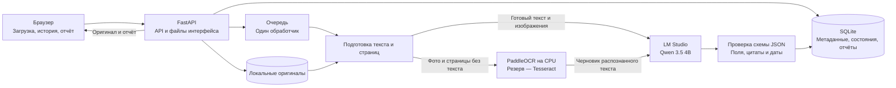

# Архитектура DocFlow

DocFlow проверяет документы на одном компьютере. Браузер работает с API FastAPI. Сервер подготавливает файл, при необходимости распознаёт текст, запрашивает структурированный ответ у Qwen и формирует отчёт по выбранному плану.

## Компоненты

| Компонент | Ответственность |
|---|---|
| [`frontend/`](../doccheck/frontend/) | HTML, CSS и JavaScript. Загрузка и просмотр файлов, история, планы, состояние Qwen и OCR, отчёты и экспорт. Переходы внутри страницы через URL-фрагменты. |
| [`backend/app.py`](../doccheck/backend/app.py) | REST API, выдача интерфейса, проверка запросов, очередь, локальное хранилище и выгрузка отчётов. |
| [`backend/documents.py`](../doccheck/backend/documents.py) | Проверка форматов, извлечение текста PDF, подготовка изображений, выбор OCR и резервное распознавание. |
| [`backend/paddle_ocr_worker.py`](../doccheck/backend/paddle_ocr_worker.py) | Отдельный процесс PaddleOCR на CPU. `PP-OCRv5_mobile_det` находит строки, `eslav_PP-OCRv5_mobile_rec` читает русский и английский текст. |
| [`backend/engine.py`](../doccheck/backend/engine.py) | Запрос к локальной LM Studio, схема ответа Pydantic, планы по видам документов, календарные проверки и сборка отчёта. |
| [`tests/`](../doccheck/tests/) | Автоматические проверки обработки файлов, правил отчёта и API. |

## Обработка документа

1. Пользователь загружает PDF, JPG, JPEG, PNG или WEBP. Лимит файла — 15 МБ, PDF — до трёх страниц. Сервер выдаёт идентификатор, сохраняет оригинал и добавляет запись в очередь. В очереди допускается до пяти документов с учётом выполняющегося.
2. Для PDF сервер берёт встроенный текст и визуализирует каждую страницу. Изображения приводятся к RGB, а длинная сторона уменьшается до 1 600 пикселей, если исходник больше.
3. PaddleOCR читает фото и страницы PDF без встроенного текста. Если распознавание недоступно или вернуло пустой результат на странице, сервер пробует Tesseract. Изображение остаётся доступным Qwen даже без текста OCR. Для извлечённого текста действует лимит 11 000 символов. Черновик OCR получает оставшуюся часть этого лимита.
4. Сервер отправляет текст и доступные изображения в локальную LM Studio по `/v1/chat/completions`. По умолчанию используется Qwen 3.5 4B. Модель определяет вид документа и возвращает JSON с полями и цитатами, возможными противоречиями и проблемами читаемости.
5. Сервер проверяет схему ответа и применяет план. Поддерживаются заявления о приёме, другие заявления, договоры, счета, акты, справки, приказы и письма. Для остальных случаев применяется общий план. Бэкенд проверяет календарную корректность извлечённых дат и отмечает пропуски. Росчерк оценивается по изображению в планах, где есть подпись.
6. Сервер сохраняет результат. Браузер получает состояние и показывает отчёт рядом с оригиналом. Пользователь может скачать TXT или JSON, повторить проверку либо удалить документ и его отчёт.

## API

| Метод и путь | Назначение |
|---|---|
| `GET /api/health` | Проверка доступности сервера |
| `GET /api/status` | Состояние Qwen, настройки OCR, планы и размер очереди |
| `POST /api/documents` | Загрузка документа и постановка в очередь |
| `GET /api/documents` | До 200 последних записей истории |
| `GET /api/documents/{id}` | Состояние, извлечённый текст и результат |
| `GET /api/documents/{id}/file` | Оригинал после проверки формата |
| `GET /api/documents/{id}/report` | Отчёт TXT или JSON |
| `POST /api/documents/{id}/retry` | Повтор завершённой или неудачной проверки |
| `DELETE /api/documents/{id}` | Удаление оригинала и отчёта |

## Данные и границы доступа

- Оригиналы хранятся в `data/uploads/`. SQLite в `data/history.sqlite3` хранит идентификатор и метаданные файла, статус, этап, ошибку, извлечённый текст, отчёт JSON, длительность и имя модели.
- Проверка проходит состояния `queued → running → done` или `error`. После перезапуска незавершённые записи помечаются как прерванные, после чего их можно повторить.
- При локальной работе документы обрабатываются на ПК. Сервер ограничивает адрес LM Studio интерфейсом loopback и проверяет `Host`, `Origin` и заголовок приложения для изменяющих запросов.
- Рабочие документы, история и веса моделей хранятся вне Git. В отчёте фиксируется OCR, чей текст использовался при проверке. Подлинность подписи и выводы по документу подтверждает человек.
